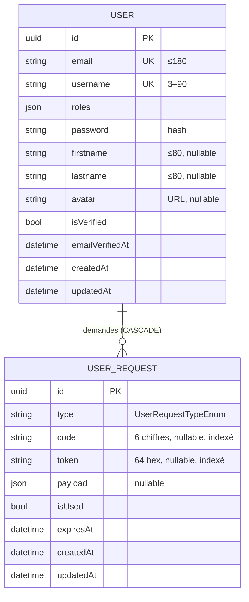

# API — Socle technique

## 1. Objet

Architecture, conventions et sécurité partagées par tous les modules de l'API.

## 2. Stack

| Élément | Version / choix |
|---|---|
| PHP | ≥ 8.4 |
| Symfony | 8.1 (framework, security, serializer, validator, twig, mailer, uid) |
| ORM | Doctrine ORM 3 + Migrations ; SGBD **MySQL / MariaDB** (UUID en `BINARY(16)`, `utf8mb4`) |
| Auth | `lexik/jwt-authentication-bundle` 3 (RS256, clés dans `config/jwt/`) |
| CORS | `nelmio/cors-bundle` |
| Socle maison | `fagathe-dev/core-php` (dépôt Git privé) : réponses, logs, upload, mailer, commandes |
| Dev | maker-bundle, doctrine-fixtures, faker |

## 3. Architecture

```
Requête → Controller (mince) → Service (logique) → Repository / EntityManager
                    ↑                 │
                    └── objet réponse ┘  {data, status, headers, context}
```

| Couche | Règle |
|---|---|
| **Controller** | Attributs `#[Route]` + `#[IsGranted]`. Ne contient pas de logique : délègue au service et convertit son retour via `$this->json($res->data, $res->status, $res->headers, $res->context)`. |
| **Service** | `final`, injecté par autowiring. Utilise les traits `core-php` : `ResponseTrait` (réponses), `DatetimeTrait` (`now()`, `isPastDate()`), `LoggerTrait` (`generateLog()`), `RequestTrait` (`getOrigin()`, `getUserAgent()`). Récupère l'utilisateur via `Security::getUser()`. |
| **DTO** | Classes `final` à propriétés publiques + contraintes `Assert`. Désérialisées par le serializer puis validées. |
| **Entity** | Attributs Doctrine ; exposition contrôlée par `#[Groups]`. |
| **Repository** | `save($entity, flush, isCreation)` / `remove($entity, flush)` retournant `bool`. |

- Toutes les routes sont préfixées par **`/api`** (`config/routes.yaml`).
- Paramètres liés (`config/services.yaml`) : `$projectDir`, `$defaultUri` (= `DEFAULT_URI`). `FRONTEND_URL` est injecté via `#[Autowire('%env(default::FRONTEND_URL)%')]`.
- Les services de `core-php` sont enregistrés via le bundle `CorePhpBundle` et `services.yaml`.

## 4. Conventions d'échange

### 4.1 Format
- JSON en entrée et en sortie (`Content-Type: application/json`). Upload : `multipart/form-data`.
- Identifiants : **UUID v7** (générés dans le constructeur des entités).
- Dates : ISO 8601 (`2026-10-27T09:12:00+01:00`), fuseau `Europe/Paris` (`framework.serializer.default_context`).
- Noms de champs : ceux des propriétés (camelCase pour le socle).

### 4.2 Secrets encodés
Les secrets saisis par l'utilisateur transitent **encodés en base64 UTF-8** (front : `encodeSecret`, API : `SecretDecoder`). Le décodage a lieu **avant** validation et hash.

| Endpoint | Champs encodés |
|---|---|
| `POST /auth/register` | `password` |
| `POST /auth/login` | `password` |
| `POST /auth/reset-password` | `password` |
| `PUT /account/password` | `currentPassword`, `newPassword` |

Base64 invalide (mode strict) ou UTF-8 invalide → **400** `Format de données invalide.`

> Ce n'est pas du chiffrement : la confidentialité repose sur HTTPS. L'encodage évite seulement l'apparition des mots de passe en clair dans les payloads.

### 4.3 Réponses

| Cas | Statut | Corps |
|---|---|---|
| Ressource | 200 / 201 | Objet ou tableau sérialisé selon les groupes |
| Action | 200 | `{ "message": "…" }` (+ champs éventuels) |
| Suppression | 204 | vide |
| Erreur simple | 4xx / 5xx | `{ "message": "…" }` |
| Erreur avec code métier | 4xx | `{ "code": "email_not_verified", "message": "…" }` |
| Validation | **400** | `{ "title": "Validation failed !", "violations": { "<champ>": "<message>" }, "status": 400 }` |

Les messages sont **en français** et destinés à être affichés tels quels.

### 4.4 Codes HTTP utilisés

| Code | Signification dans le socle |
|---|---|
| 400 | JSON / base64 invalide, violations de validation, jeton de lien invalide ou expiré |
| 401 | Non authentifié, identifiants ou code invalides |
| 403 | Accès refusé (rôle, propriété), compte non vérifié |
| 404 | Ressource introuvable |
| 409 | Conflit d'unicité découvert tardivement (e-mail pris entre-temps) |
| 422 | Donnée métier refusée (mot de passe actuel faux, code invalide, domaine e-mail injoignable, fichier refusé) |
| 429 | Trop de tentatives / renvoi trop rapproché |
| 500 | Erreur interne (toujours journalisée en `critical`) |
| 502 | Échec du transport e-mail |
| 503 | Health-check dégradé |

## 5. Sécurité

### 5.1 Firewall (`config/packages/security.yaml`)
- Firewall `api` : `^/api`, **stateless**, authentification JWT (`Authorization: Bearer <token>`).
- Provider : entité `User`, propriété **`username`**.
- Hachage : `auto` (bcrypt / argon selon PHP).
- Hiérarchie : `ROLE_ADMIN` ⊃ `ROLE_USER`.

| Chemin | Accès |
|---|---|
| `^/api/auth/` | Public |
| `^/api/health-check` | Public |
| `^/api/admin` | `ROLE_ADMIN` |
| `^/api/` | `IS_AUTHENTICATED_FULLY` |

### 5.2 Autorisation par propriété — `OwnerVoter`
- Attributs : `IS_OWNER`, `VIEW`, `EDIT`, `DELETE` (tous équivalents : propriétaire uniquement).
- Supporte tout objet exposant `getOwner()`, `getUser()`, `getAuthor()` ou `getCreator()` renvoyant un `UserInterface`.
- Comparaison par `getUserIdentifier()`.
- Usage : `$this->denyAccessUnlessGranted(OwnerVoter::EDIT, $resource);`

### 5.3 Anti-énumération
Les endpoints publics qui prennent un identifiant (`login-code`, `resend-verification`, `forgot-password`) renvoient **toujours la même réponse**, que le compte existe ou non. `login` exécute un hash factice si l'utilisateur est inconnu pour lisser le temps de réponse.

### 5.4 CORS
`nelmio_cors` : origine = regex `CORS_ALLOW_ORIGIN`, méthodes `GET, OPTIONS, POST, PUT, PATCH, DELETE`, tous en-têtes autorisés, `max_age` 3600.

### 5.5 Limitation de débit
Implémentée « à la main » via le pool `cache.app` (clés par utilisateur). Pas de `symfony/rate-limiter`. Détail dans [auth_module.md](auth_module.md) et [account_module.md](account_module.md).

## 6. Modèle de données du socle



Groupe de sérialisation exposé : `user.read` = `id, email, roles, username, firstname, lastname, avatar, createdAt, updatedAt`. Jamais exposés : `password`, `isVerified`, `emailVerifiedAt`.

## 7. Briques `core-php` utilisées

| Brique | Usage |
|---|---|
| `Http\ResponseTrait` | `sendJson`, `sendNoContent`, `sendViolations` |
| `Trait\LoggerTrait` | Logs JSON par classe (voir [log_module.md](log_module.md)) |
| `Mailer\AbstractMailerHandler` | Base des handlers e-mail (voir [mailer_module.md](mailer_module.md)) |
| `Uploader\UploaderService` / `UploaderValidationService` | Upload de l'avatar |
| `Generator\TokenGenerator` | Jetons aléatoires |
| `Command\CreateAdminUserCommand` + `AdminUserManagerInterface` | Création d'admins (voir [auth_module.md](auth_module.md)) |
| `Command\LogFilesRotationCommand` | Purge des logs |
| Templates `@CorePhp/layout.html.twig` + `components/*` | Mise en page des e-mails |

## 8. Écarts & points ouverts

- `doctrine.yaml` déclare une préférence d'identité PostgreSQL alors que la base est MySQL (sans effet, à nettoyer).
- `KnpPaginatorBundle` est activé et `PaginationTrait` injecté dans certains services, mais aucune pagination n'est appliquée.
- La vérification « utilisateur authentifié » est dupliquée dans chaque méthode de service (`getAuthenticatedUser()` répété) alors que le firewall la garantit déjà : candidate à factorisation.
- Les 403 du voter renvoient le format d'erreur Symfony par défaut, différent de `{ message }`.

## 9. Sources

`api/config/packages/{security,framework,doctrine,nelmio_cors,lexik_jwt_authentication}.yaml`, `api/config/{routes,services}.yaml`, `api/src/Security/Voter/OwnerVoter.php`, `api/src/Service/SecretDecoder.php`, `vendor/fagathe-dev/core-php/src/Http/ResponseTrait.php`.
