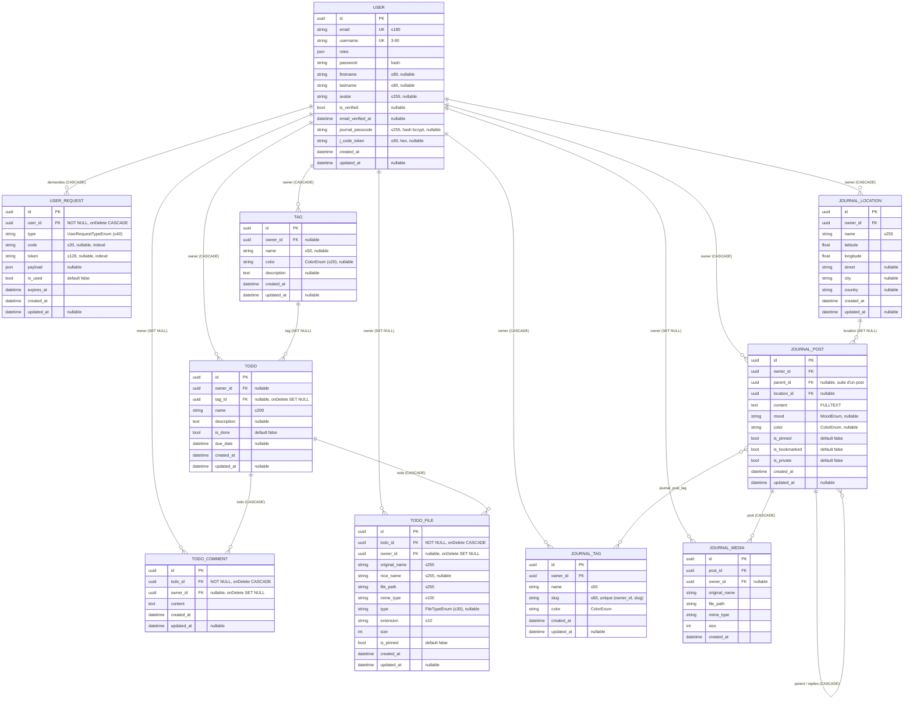

# Structure de données — Modèle complet (Doctrine ORM)

## 1. Objet

Référence exhaustive de la structure de données de l'application (`api/src/Entity/` et `api/src/Enum/`) :
- **2 superclasses mappées** (`#[ORM\MappedSuperclass]`) : `AbstractTextEntry`, `AbstractFile`.
- **10 entités persistantes** (`#[ORM\Entity]`) + 1 table de jointure :
  - **Socle** : `User`, `UserRequest`.
  - **Tâches** : `Tag`, `Todo`, `TodoComment`, `TodoFile`.
  - **Journal** : `JournalPost`, `JournalTag`, `JournalMedia`, `JournalLocation` (+ jointure `journal_post_tag`). Les entités du journal sont dans `App\Entity` comme les autres : le module est isolé fonctionnellement, pas par namespace.
- **5 énumérations** (`api/src/Enum/`) : `RoleEnum`, `UserRequestTypeEnum`, `ColorEnum`, `MoodEnum`, `JournalTabEnum` (+ `FileTypeEnum` de `fagathe-dev/core-php`).

> Le module Notes (`Note`, `NoteFile`, `StateEnum`) et l'ancien journal par blocs (`Entry`, `BlocContent`, `EntryMedia`, `Location`, `BlockTypeEnum`) ont été supprimés ; reprise des données : [infrastructure_module.md](infrastructure_module.md#migration-journal-v2).

SGBD cible : **MySQL / MariaDB** (`utf8mb4`). Tous les identifiants primaires sont des **UUID v7** (`Symfony\Component\Uid\Uuid::v7()`) stockés sous forme `BINARY(16)` via le type Doctrine `uuid` (`UuidType::NAME`).

---

## 2. Diagramme Entité-Association global

---

## 3. Superclasses mappées (`#[ORM\MappedSuperclass]`)

### 3.1 `AbstractTextEntry` (`src/Entity/AbstractTextEntry.php`)
Base des contenus textuels datés et épinglables (aujourd'hui : `JournalPost`).

| Propriété PHP | Colonne SQL | Type Doctrine | Nullable | Défaut | Groupes de sérialisation |
|---|---|---|---|---|---|
| `id` | `id` | `uuid` (`BINARY(16)`) | non | `Uuid::v7()` | `journal_post.list`, `journal_post.read` |
| `created_at` | `created_at` | `datetime_immutable` | non | — | `journal_post.list`, `journal_post.read` |
| `updated_at` | `updated_at` | `datetime_immutable` | oui | `null` | `journal_post.list`, `journal_post.read` |
| `is_pinned` | `is_pinned` | `boolean` | non | `false` | `journal_post.list`, `journal_post.read` |

> **Remarque de nommage** : les propriétés PHP de `AbstractTextEntry` sont en `snake_case` (`created_at`, `updated_at`, `is_pinned`), et sont donc sérialisées sous ces noms en JSON.

### 3.2 `AbstractFile` (`src/Entity/AbstractFile.php`)
Base commune à toutes les pièces jointes (`TodoFile`, `JournalMedia`). Gérée par `AttachmentFileService`.

| Propriété PHP | Colonne SQL | Type Doctrine | Nullable | Défaut | Groupes |
|---|---|---|---|---|---|
| `id` | `id` | `uuid` (`BINARY(16)`) | non | `Uuid::v7()` | `journal_post.list`, `journal_post.read` |
| `originalName` | `original_name` | `string(255)` | non | — | `file.read` |
| `niceName` | `nice_name` | `string(255)` | oui | `null` | `file.read` |
| `filePath` | `file_path` | `string(255)` | non | — (URL absolue) | `file.read` |
| `mimeType` | `mime_type` | `string(100)` | non | — | `file.read` |
| `type` | `type` | `FileTypeEnum` (`string(30)`) | oui | `null` | `file.read` |
| `extension` | `extension` | `string(10)` | non | — | `file.read` |
| `size` | `size` | `integer` | non | — (octets) | `file.read` |
| `isPinned` | `is_pinned` | `boolean` | non | `false` | `file.read` |
| `createdAt` | `created_at` | `datetime_immutable` | non | `now` | `file.read` |
| `updatedAt` | `updated_at` | `datetime_immutable` | oui | `null` | `file.read` |

---

## 4. Entités du socle

### 4.1 `User` (`src/Entity/User.php`)
Compte utilisateur, implémente `UserInterface` et `PasswordAuthenticatedUserInterface`.

- **Contraintes d'unicité** :
  - `UNIQ_IDENTIFIER_EMAIL` sur `email` (`UniqueEntity`)
  - `UNIQ_IDENTIFIER_USERNAME` sur `username` (`UniqueEntity`)

| Propriété PHP | Type Doctrine | Nullable | Contraintes / Détail | Groupes |
|---|---|---|---|---|
| `id` | `uuid` | non | `Uuid::v7()` | `user.read` |
| `email` | `string(180)` | non | `NotBlank`, `Email`. Retourné par `getUserIdentifier()` | `user.read` |
| `username` | `string(90)` | non | `NotBlank`, `Length(min: 3, max: 90)`. Utilisé par le user provider Symfony / JWT | `user.read` |
| `roles` | `json` | non | `getRoles()` garantit toujours `ROLE_USER` | `user.read` |
| `password` | `string(255)` | non | Hashé (`auto`), `NotBlank`, `Regex` | — |
| `firstname` | `string(80)` | oui | Prénom | `user.read` |
| `lastname` | `string(80)` | oui | Nom | `user.read` |
| `avatar` | `string(255)` | oui | URL publique de l'avatar (`uploads/avatars/<userId>/...`) | `user.read` |
| `isVerified` | `boolean` | oui | Statut d'activation du compte | — |
| `emailVerifiedAt` | `datetime_immutable` | oui | Date de vérification de l'e-mail | — |
| `journalPasscode` | `string(255)` | oui | Code secret du journal hashé en `PASSWORD_BCRYPT` | — |
| `jCodeToken` | `string(90)` | oui | Jeton de déverrouillage du journal (80 car. hex) comparé à `X-JOURNAL-AUTH` | — |
| `journalLockEnabled` | `boolean` | non | `default: false`. Protection par code des contenus privés ; effective seulement avec un code (`isJournalLockActive()`) | — |
| `createdAt` | `datetime_immutable` | non | Date d'inscription | `user.read` |
| `updatedAt` | `datetime_immutable` | oui | Dernière modification | `user.read` |

- **Collections `OneToMany` portées par `User`** :
  - `tags` (`Tag`, `cascade: ['remove', 'persist']`, `orphanRemoval: true`)
  - `todos` (`Todo`, `cascade: ['remove', 'persist']`, `orphanRemoval: true`)
  - `journalPosts` (`JournalPost`, `cascade: ['remove', 'persist']`, `orphanRemoval: true`)
  - `journalTags` (`JournalTag`, `cascade: ['remove', 'persist']`, `orphanRemoval: true`)
  - `journalLocations` (`JournalLocation`, `cascade: ['remove', 'persist']`, `orphanRemoval: true`)
  - `todoFiles` (`TodoFile`, `cascade: ['persist']`)
  - `journalMedia` (`JournalMedia`, `cascade: ['persist']`)

### 4.2 `UserRequest` (`src/Entity/UserRequest.php`)
Jetons et codes OTP temporaires à usage unique (inscription, connexion par code, reset password, changement d'e-mail, suppression de compte).

- **Index** : `idx_user_request_token` (`token`), `idx_user_request_code` (`code`).

| Propriété PHP | Type Doctrine | Nullable | Détail | Groupes |
|---|---|---|---|---|
| `id` | `uuid` | non | `Uuid::v7()` | `user_request.read` |
| `user` | `ManyToOne(User)` | non | `onDelete: 'CASCADE'` | — |
| `type` | `UserRequestTypeEnum` (`string(40)`) | non | Nature de la demande | — |
| `code` | `string(20)` | oui | Code OTP à 6 chiffres (`100000`–`999999`) | — |
| `token` | `string(128)` | oui | Jeton hexadécimal de 64 caractères (`random_bytes(32)`) | — |
| `payload` | `json` | oui | Contexte additionnel (ex. `{"new_email": "..."}`) | — |
| `isUsed` | `boolean` | non | `default: false` | — |
| `expiresAt` | `datetime_immutable` | non | Date d'expiration | — |
| `createdAt` | `datetime_immutable` | non | Date de création | — |
| `updatedAt` | `datetime_immutable` | oui | Date de consommation / révocation | — |

---

## 5. Entités métier

### 5.1 `Tag` (`src/Entity/Tag.php`)
Étiquette colorée des tâches (le journal a ses propres `JournalTag`, §5.5).

- **Contrainte d'unicité** : `uniq_user_tag_color` sur `(owner, color)` — un utilisateur ne peut avoir qu'un seul tag par couleur de `ColorEnum`.

| Propriété PHP | Type Doctrine | Nullable | Détail | Groupes |
|---|---|---|---|---|
| `id` | `uuid` | non | `Uuid::v7()` | `tag.list`, `tag.read`, `todo.read`, `todo.list` |
| `name` | `string(50)` | oui | `NotBlank` | `tag.list`, `tag.read`, `todo.read`, `todo.list` |
| `color` | `ColorEnum` (`string(20)`) | oui | Couleur parmi les 13 valeurs de `ColorEnum` | `tag.list`, `tag.read`, `todo.read`, `todo.list` |
| `description` | `text` | oui | Description optionnelle | `tag.read` |
| `owner` | `ManyToOne(User)` | oui | Propriétaire du tag | — |
| `createdAt` | `datetime_immutable` | non | Date de création | `tag.read` |
| `updatedAt` | `datetime_immutable` | oui | Date de modification | `tag.read` |
| `todos` | `OneToMany(Todo)` | — | Tâches associées (`mappedBy: 'tag'`) | — |

### 5.2 `Todo` (`src/Entity/Todo.php`)
Tâche de l'utilisateur avec échéance, description Markdown, tag, pièces jointes et commentaires.

| Propriété PHP | Type Doctrine | Nullable | Détail | Groupes |
|---|---|---|---|---|
| `id` | `uuid` | non | `Uuid::v7()` | `todo.read`, `todo.list` |
| `name` | `string(200)` | non | Intitulé de la tâche | `todo.read`, `todo.list` |
| `isDone` | `boolean` | non | `default: false` | `todo.read`, `todo.list` |
| `dueDate` | `datetime_immutable` | oui | Normalisée à `23:59:59` (`Europe/Paris`) par `TodoService` | `todo.read`, `todo.list` |
| `description` | `text` | oui | Description (éditée en Markdown côté front) | `todo.read` |
| `owner` | `ManyToOne(User)` | oui | Propriétaire | — |
| `tag` | `ManyToOne(Tag)` | oui | `onDelete: 'SET NULL'` | `todo.list`, `todo.read` |
| `files` | `OneToMany(TodoFile)` | — | `cascade: ['persist', 'remove']`, `orphanRemoval: true` | `todo.read`, `todo.list` |
| `comments` | `OneToMany(TodoComment)` | — | Commentaires liés (`mappedBy: 'todo'`) | `todo.read`, `todo.list` |
| `createdAt` | `datetime_immutable` | non | Initialisé dans `__construct()` | `todo.read`, `todo.list` |
| `updatedAt` | `datetime_immutable` | oui | Mis à jour par `TodoRepository::save()` | `todo.read` |

### 5.3 `TodoComment` (`src/Entity/TodoComment.php`)
Commentaire sur une tâche.

| Propriété PHP | Type Doctrine | Nullable | Détail | Groupes |
|---|---|---|---|---|
| `id` | `uuid` | non | `Uuid::v7()` | `todo.read`, `todo.list` |
| `todo` | `ManyToOne(Todo)` | non | `onDelete: 'CASCADE'` | — |
| `owner` | `ManyToOne(User)` | oui | `onDelete: 'SET NULL'` | `todo.read`, `todo.list` |
| `content` | `text` | non | Texte du commentaire (≤ 5000 car. via DTO) | `todo.read`, `todo.list` |
| `createdAt` | `datetime_immutable` | non | Date d'ajout | `todo.read`, `todo.list` |
| `updatedAt` | `datetime_immutable` | oui | Date de modification | `todo.read` |

### 5.4 `TodoFile` (`src/Entity/TodoFile.php`)
Pièce jointe d'une tâche. Hérite de `AbstractFile` (§3.2). Stockée sur disque dans `public/uploads/todos/<userId>/`.

| Propriété PHP | Type Doctrine | Nullable | Détail |
|---|---|---|---|
| *(champs `AbstractFile`)* | — | — | Exposés via `file.read` |
| `todo` | `ManyToOne(Todo)` | non | `inversedBy: 'files'`, `onDelete: 'CASCADE'` |
| `owner` | `ManyToOne(User)` | oui | `inversedBy: 'todoFiles'`, `onDelete: 'SET NULL'` |

### 5.5 `JournalTag` (`src/Entity/JournalTag.php`, table `journal_tag`)
Tag propre au journal. Unicité `(owner, slug)` (`uniq_journal_tag_owner_slug`) ; plusieurs tags peuvent partager une couleur.

| Propriété PHP | Type Doctrine | Nullable | Détail | Groupes |
|---|---|---|---|---|
| `id` | `uuid` | non | `Uuid::v7()` | `journal_tag.list`, `journal_tag.read`, `journal_post.list`, `journal_post.read` |
| `owner` | `ManyToOne(User)` | non | `onDelete: 'CASCADE'` | — |
| `name` | `string(50)` | non | `NotBlank`, `Length(max: 50)` | idem `id` |
| `slug` | `string(60)` | non | `AsciiSlugger` (minuscules), sert au filtre `?tag=` | idem `id` |
| `color` | `ColorEnum` (`string(20)`) | non | `NotNull` | idem `id` |
| `createdAt` / `updatedAt` | `datetime_immutable` | non / oui | — | `journal_tag.read` |
| `posts` | `ManyToMany(JournalPost)` | — | `mappedBy: 'tags'` | — |

### 5.6 `JournalPost` (`src/Entity/JournalPost.php`, table `journal_post`)
Post ou suite du journal. Hérite de `AbstractTextEntry` (§3.1). Index : `owner_id`, `parent_id`, `location_id`, `(owner_id, is_private)`, `created_at`, **FULLTEXT** `content`.

| Propriété PHP | Type Doctrine | Nullable | Détail | Groupes |
|---|---|---|---|---|
| *(champs `AbstractTextEntry`)* | — | — | `id`, `created_at`, `updated_at`, `is_pinned` | `journal_post.list`, `journal_post.read` |
| `content` | `text` | non | Markdown (`''` si le post n'a que des médias) | idem |
| `mood` | `MoodEnum` (`string(50)`) | oui | Humeur | idem |
| `color` | `ColorEnum` (`string(30)`) | oui | Couleur | idem |
| `is_bookmarked` | `boolean` | non | `default: false` | idem |
| `is_private` | `boolean` | non | `default: false` ; propagé aux suites (`setIsPrivate`) | idem |
| `owner` | `ManyToOne(User)` | non | `onDelete: 'CASCADE'` | — |
| `parent` | `ManyToOne(self)` | oui | `inversedBy: 'replies'`, `onDelete: 'CASCADE'` ; exposé via `getParentId()` → `parent_id` | idem |
| `replies` | `OneToMany(self)` | — | `orderBy: created_at ASC`, `cascade: ['persist', 'remove']`, `orphanRemoval`, `MaxDepth(1)` | idem |
| `location` | `ManyToOne(JournalLocation)` | oui | `cascade: ['persist']`, `onDelete: 'SET NULL'` | idem |
| `tags` | `ManyToMany(JournalTag)` | — | Jointure `journal_post_tag` (`journal_post_id`, `journal_tag_id`, `ON DELETE CASCADE`) | idem |
| `medias` | `OneToMany(JournalMedia)` | — | `cascade: ['persist', 'remove']`, `orphanRemoval` | idem (+ `file.read`) |

### 5.7 `JournalMedia` (`src/Entity/JournalMedia.php`, table `journal_media`)
Média d'un post (images, audio, vidéo). Hérite de `AbstractFile` (§3.2). Stocké dans `public/uploads/journal/<userId>/`.

| Propriété PHP | Type Doctrine | Nullable | Détail |
|---|---|---|---|
| `post` | `ManyToOne(JournalPost)` | non | `inversedBy: 'medias'`, `onDelete: 'CASCADE'` |
| `owner` | `ManyToOne(User)` | oui | `inversedBy: 'journalMedia'`, `onDelete: 'SET NULL'` |

### 5.8 `JournalLocation` (`src/Entity/JournalLocation.php`, table `journal_location`)
Lieu d'un post (géolocalisation + géocodage Nominatim côté front).

| Propriété PHP | Type Doctrine | Nullable | Détail | Groupes |
|---|---|---|---|---|
| `id` | `uuid` | non | `Uuid::v7()` | `journal_post.list`, `journal_post.read` |
| `owner` | `ManyToOne(User)` | non | `onDelete: 'CASCADE'` | — |
| `name` | `string(255)` | non | Libellé (`Paris, France` ou `lat, lon`) | idem `id` |
| `latitude` / `longitude` | `float` | non | Coordonnées GPS | idem `id` |
| `street` / `city` / `country` | `string(255)` | oui | Adresse géocodée | idem `id` |
| `created_at` / `updated_at` | `datetime_immutable` | non / oui | — | — |

---

## 6. Référentiel des Énumérations (`api/src/Enum/`)

| Enum | Namespace | Valeurs |
|---|---|---|
| `RoleEnum` | `App\Enum\Auth` | `ROLE_USER` (« Utilisateur »), `ROLE_ADMIN` (« Administrateur ») |
| `UserRequestTypeEnum` | `App\Enum\Auth` | `otp_register` *(inutilisé)*, `otp_login`, `email_verification`, `password_reset`, `email_change`, `account_deletion` |
| `ColorEnum` | `App\Enum` | `red`, `orange`, `yellow`, `green`, `blue`, `cyan`, `purple`, `violet`, `fuchsia`, `pink`, `slate`, `gray`, `stone` (13 couleurs) |
| `JournalTabEnum` | `App\Enum` | `feed`, `memories`, `bookmarks`, `private` (paramètre `?tab=` de `GET /journal/posts` ; `private` exige le code si la protection est active) |
| `MoodEnum` | `App\Enum` | `angry` (😡 En colère), `anxious` (😟 Anxieux), `exhausted` (😫 Épuisé), `frustrated` (😤 Frustré), `grateful` (🙏 Reconnaissant), `happy` (🙂 Heureux), `lost` (😕 Perdu), `hopeful` (🤞 Plein d'espoir), `in_love` (😍 Amoureux), `neutral` (😐 Neutre), `motivated` (💪 Motivé), `relaxed` (😌 Détendu), `radiant` (🤩 Rayonnant), `sad` (😔 Triste), `stressed` (😰 Stressé) |
| `FileTypeEnum` | `Fagathe\CorePhp\File` | `Archive`, `Audio`, `Code`, `Image`, `PDF`, `Présentation`, `Tableur`, `Traitement de texte`, `Texte`, `Vidéo` |

---

## 7. Synthèse des groupes de sérialisation

| Groupe | Utilisé par | Champs exposés |
|---|---|---|
| `user.read` | Auth, Account, Todo (`owner` commentaire) | `User`: `id, email, roles, username, firstname, lastname, avatar, createdAt, updatedAt` |
| `tag.list` | `GET /tags` | `Tag`: `id, name, color` |
| `tag.read` | `POST/GET/PUT /tags` | `Tag`: `id, name, color, description, createdAt, updatedAt` |
| `todo.list` | `GET /todos` | `Todo`: `id, name, isDone, dueDate, createdAt, tag, files, comments` ; `Tag`: `id, name, color` ; `TodoComment`: `id, content, owner, createdAt` |
| `todo.read` | `POST/GET/PUT /todos/{id}`, `POST /todos/{id}/comments` | Idem `todo.list` + `Todo`: `updatedAt, description` ; `TodoComment`: `updatedAt` |
| `journal_post.list` / `journal_post.read` | Routes `/journal/posts` (avec `file.read`, `enable_max_depth`) | `JournalPost`: `id, content, mood, color, is_pinned, is_bookmarked, is_private, parent_id, created_at, updated_at, location, tags, medias, replies` (1 niveau) |
| `journal_tag.read` | Routes `/journal/tags` | `JournalTag`: `id, name, slug, color, createdAt, updatedAt` (+ `postCount` ajouté par le service en liste) |
| `file.read` | Routes `Todo` et `/journal/posts` | `AbstractFile`: `id, originalName, niceName, filePath, mimeType, type, extension, size, isPinned, createdAt, updatedAt` |

---

## 8. Écarts & points ouverts sur le modèle de données

- **Conventions de casse hétérogènes** : `AbstractTextEntry` / `JournalPost` (`created_at`, `is_pinned`, `is_private`…) et `JournalLocation` sont en `snake_case`, tandis que `User`, `Tag`, `Todo`, `TodoComment`, `JournalTag` et `AbstractFile` sont en `camelCase`. Le front suit chaque convention telle quelle.
- **`Todo::$comments` sans cascade ORM `remove`** : `TodoComment::$todo` a `onDelete: 'CASCADE'` au niveau SQL, mais `Todo::$comments` n'a pas `cascade: ['remove']` côté Doctrine.
- **Médias migrés** : les médias repris de l'ancien journal gardent leur chemin `uploads/entries/…`.
