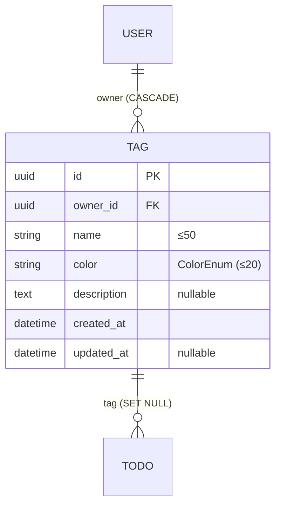

# Module Tag

## 1. Objet

Gestion des **tags colorés** propres à chaque utilisateur pour organiser et filtrer visuellement ses **tâches** (`Todo`), ses **notes** (`Note`) et ses **entrées de journal** (`Entry`).

> Ce module fait partie du périmètre métier de l'application ([extraction_guide.md](extraction_guide.md)).

## 2. Règles métier

| ID | Règle |
|---|---|
| RG-TAG-01 | Un tag appartient à un utilisateur (`owner`) et comporte un `name` (obligatoire, ≤ 50 car.), une `color` (obligatoire parmi les 13 valeurs de `ColorEnum`) et une `description` optionnelle (`text`). |
| RG-TAG-02 | **Unicité de la couleur par utilisateur** : un utilisateur ne peut posséder qu'un seul tag d'une couleur donnée (`UniqueConstraint(owner, color)` + vérification explicite via `TagRepository::colorExistsForUser`). Au maximum 13 tags par utilisateur. |
| RG-TAG-03 | Seul le propriétaire (`OwnerVoter`) peut consulter, modifier ou supprimer un tag. |
| RG-TAG-04 | La suppression d'un tag détache les `Todo` associés (`onDelete: 'SET NULL'` + détachement en mémoire des `todos` dans `TagRepository::remove`). Les tags sont propres aux tâches : le journal a ses propres `JournalTag`. |
| RG-TAG-06 | `GET /tags?usedIn=todos` ne renvoie que les tags rattachés à au moins une tâche (barre de filtres de la page Tâches) ; toute autre valeur de `usedIn` → 400. |
| RG-TAG-05 | Les 13 couleurs supportées (`ColorEnum`) sont : `red`, `orange`, `yellow`, `green`, `blue`, `cyan`, `purple`, `violet`, `fuchsia`, `pink`, `slate`, `gray`, `stone`. |

## 3. Modèle de données

Entité `Tag` (`src/Entity/Tag.php`) et énumération `ColorEnum` (`src/Enum/ColorEnum.php`). Voir [data_model.md §5.1](data_model.md#51-tag-srcentitytagphp).



## 4. API — `/api/tags` (authentifié)

| Méthode | Route | Corps | Succès | Erreurs |
|---|---|---|---|---|
| GET | `/tags?usedIn=todos` | — | 200 `Tag[]` (`tag.list`) ; avec `usedIn=todos`, uniquement les tags utilisés par au moins une tâche | 400 `usedIn` inconnu · 401 |
| POST | `/tags` | `{ name, color, description? }` | **201** `Tag` (`tag.read`) | 400 JSON / violations (nom manquant, couleur déjà utilisée par l'utilisateur) · 500 |
| GET | `/tags/{id}` | — | 200 `Tag` (`tag.read`) | 403 non propriétaire · 404 introuvable |
| PUT | `/tags/{id}` | `{ name?, color?, description? }` | 200 `Tag` (`tag.read`) | 400 JSON / violations (dont couleur déjà prise) · 403 · 404 · 500 |
| DELETE | `/tags/{id}` | — | **204** | 403 · 404 · 500 |
| GET | `/tags/{id}/todos` | — | 200 `Todo[]` (`task.list`) | 403 · 404 |

Groupes de sérialisation :
- `tag.list` : `id, name, color`
- `tag.read` : `id, name, color, description, createdAt, updatedAt`

## 5. Frontend

### Onglet « Tags » de la page Tâches (`/todos?tab=tags` ; `/tags` y redirige)

| Composant | Rôle |
|---|---|
| `TagManager` | Liste des tags (`fetchTags`), `EmptyState`, création / édition en modale, suppression via `ConfirmDialog`, retours par `useToast`. |
| `TagFormModal` | `Modal` du kit : nom, description, `ColorSwatchPicker` (palette `tagColors`), aperçu `TagBadge`. |
| `TagList` / `TagListItem` | Liste dans une `Card` : `TagBadge`, description, `IconButton` modifier / supprimer. |
| `TagListSkeleton` | Squelette de chargement. |
| `TagSelectDropdown` | `Dropdown` du kit pour choisir le tag d'une tâche (`TodoEditForm`). |

Composants partagés (`src/components/`) : `TagBadge` (`Badge` du kit avec `$color`), `ColorDot`, `ColorSwatchPicker`, `FilterChip`.

### Palette front (`types/tag.types.ts`)
```ts
export const tagColors = {
  red: '#e7000b', orange: '#f54900', yellow: '#fdc700', green: '#00a63e',
  cyan: '#0092b8', blue: '#155dfc', purple: '#9810fa', violet: '#7f22fe',
  fuchsia: '#c800de', pink: '#e60076', slate: '#45556c', gray: '#4a5565', stone: '#57534d',
} as const;
```

## 6. Écarts & points ouverts

- **Validation de `color` dans `CreateTagDto` / `UpdateTagDto`** : les DTO ne portent pas de contrainte `#[Assert\Choice(callback: [ColorEnum::class, 'values'])]`. Si une couleur hors enum est envoyée, `ColorEnum::tryFrom()` renvoie `null`, `colorExistsForUser()` renvoie `false` et le tag est enregistré avec `color = null`.
- **Route `GET /tags/{id}/todos`** : dans `TagController::listTodos`, la réponse utilise le groupe `task.list` qui n'existe sur aucune propriété de `Todo` (au lieu de `todo.list`), et comporte un commentaire `// TODO`. Cette route n'est pas appelée par le front.

## 7. Sources

API : `src/Controller/TagController.php`, `src/Service/TagService.php`, `src/Entity/Tag.php`, `src/Repository/TagRepository.php`, `src/Dto/Tag/{CreateTagDto,UpdateTagDto}.php`, `src/Enum/ColorEnum.php`.
Front : `src/pages/tags/{TagManager.tsx,components/*}`, `src/components/{TagBadge,ColorDot,ColorSwatchPicker,FilterChip}.tsx`, `src/services/tag.api.ts`, `src/types/tag.types.ts`.
