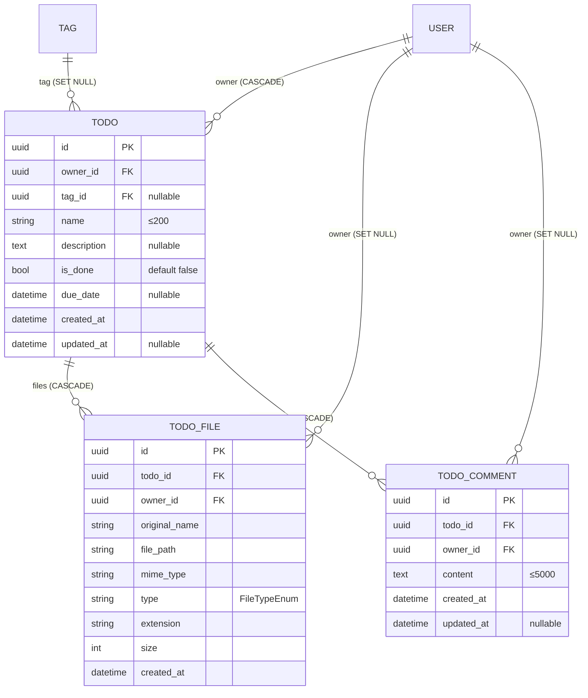

# Module Todo (Tâches)

## 1. Objet

Gestion des **tâches quotidiennes** (« Ma journée ») de l'utilisateur connecté : création rapide, classement automatique par catégorie d'échéance, suivi d'avancement (`isDone`), description en Markdown, tag, pièces jointes (`TodoFile`) et fil de commentaires (`TodoComment`).

> Ce module fait partie du périmètre métier de l'application ([extraction_guide.md](extraction_guide.md)).

## 2. Règles métier

| ID | Règle |
|---|---|
| RG-TODO-01 | Une tâche appartient à son créateur (`owner`). Seul le propriétaire (`OwnerVoter`) peut la consulter, la modifier, la supprimer, y joindre des fichiers ou la commenter. |
| RG-TODO-02 | Création rapide : seul le champ `name` (obligatoire, trimé, ≤ 200 car.) est requis. La tâche est créée avec `isDone = false`. |
| RG-TODO-03 | Lorsqu'une date d'échéance (`dueDate`) est renseignée, l'API la normalise systématiquement à **`23:59:59` dans le fuseau `Europe/Paris`** (`TodoService::adjustDueDate`). |
| RG-TODO-04 | Un tag attribué à une tâche doit appartenir à l'utilisateur connecté (422 sinon). Passer `null` ou `""` retire le tag. |
| RG-TODO-05 | **Pièces jointes (`TodoFile`)** : téléversées via `POST /todos/{id}` en `multipart/form-data`. Taille max **50 Mo** par fichier, tous les types MIME supportés par `core-php` (`MimeType::getSupportedMimetypes()`). Stockées dans `public/uploads/todos/<userId>/`. |
| RG-TODO-06 | La suppression d'une tâche (`DELETE /todos/{id}`) ou d'un fichier (`DELETE /todos/{id}/files/{fileId}`) efface le(s) fichier(s) physique(s) du disque avant la suppression en base. |
| RG-TODO-07 | **Commentaires (`TodoComment`)** : texte obligatoire (trimé, ≤ 5000 car.). Un commentaire peut être supprimé par son auteur ou par le propriétaire de la tâche. |
| RG-TODO-09 | **Filtre par tag** : la page n'affiche en pastilles que les tags rattachés à au moins une tâche (`GET /api/tags?usedIn=todos`) ; « Tous » réinitialise. `GET /api/todos?tagId=<uuid>` filtre côté API ; la liste des tags utilisés est rechargée après chaque création, modification ou suppression. |
| RG-TODO-08 | **Catégorisation par échéance côté front** (`dueDate.resolver.ts`) : les tâches non terminées sont réparties dans 6 sections ordonnées : `overdue` (en retard), `today` (aujourd'hui), `tomorrow` (demain), `this_week` (d'ici dimanche), `later` (plus tard), `none` (sans échéance). Les tâches terminées (`isDone = true`) sont regroupées en bas de page. |

## 3. Modèle de données

Entités `Todo`, `TodoFile` (hérite de `AbstractFile`) et `TodoComment`. Voir [data_model.md §5.2 à §5.4](data_model.md#52-todo-srcentitytodophp).

## 4. API — `/api/todos` (authentifié)

| Méthode | Route | Corps | Succès | Erreurs |
|---|---|---|---|---|
| GET | `/todos?tagId=` | — | 200 `Todo[]` (`todo.list`, `file.read`, `user.read`), filtrées sur le tag si `tagId` | 400 `tagId` invalide · 401 |
| POST | `/todos` | `{ name }` | **201** `Todo` (`todo.read`, `file.read`, `user.read`) | 400 JSON / violations · 500 |
| GET | `/todos/{id}` | — | 200 `Todo` (`todo.read`, `file.read`, `user.read`) | 403 · 404 |
| POST / PUT | `/todos/{id}` | JSON `{ name?, description?, isDone?, dueDate?, tag? }` ou `multipart/form-data` (`files[]` + champs) | 200 `Todo` (`todo.read`, `file.read`, `user.read`) | 400 date invalide / violations · 403 · 404 · 422 tag ou fichier refusé · 500 |
| DELETE | `/todos/{id}` | — | **204** | 403 · 404 · 500 |
| DELETE | `/todos/{id}/files/{fileId}` | — | **204** | 403 · 404 fichier introuvable |
| POST | `/todos/{id}/comments` | `{ content }` | **201** `TodoComment` (`todo.read`, `user.read`) | 400 JSON / violations · 403 · 404 · 500 |
| DELETE | `/todos/{id}/comments/{commentId}` | — | **204** | 403 · 404 commentaire introuvable · 500 |

## 5. Frontend

### Route `/todos` (`TodoPage`, cible de `/`, sous `AppLayout`)

`TodoPage` : en-tête `PageHeader` et `SegmentedControl` à deux onglets portés par l'URL — **Ma journée** (`/todos`) et **Tags** (`/todos?tab=tags`, gestion des tags : voir [tag_module.md](tag_module.md)). `/tags` redirige vers l'onglet Tags.

| Composant | Rôle |
|---|---|
| `TodoBoard` | Onglet « Ma journée » : `TodoTagFilterBar`, sections d'échéance (`Section`) + « Terminées », `EmptyState`, barre de création rapide, `TodoEditForm` monté avec `key={todo.id}`, suppression via `ConfirmDialog`. |
| `TodoTagFilterBar` | Pastilles `FilterChip` des tags utilisés + « Tous ». |
| `TodoQuickCreateForm` | Barre de saisie rapide en bas d'écran (`POST /todos`). |
| `TodoList` / `TodoCard` | Carte de tâche : case à cocher circulaire avec mise à jour optimiste (`isDone`), titre barré si terminée, puce de tag colorée, échéance formatée (`DateFormatter.short`, rouge si en retard), compteurs de fichiers et de commentaires. |
| `TodoEditForm` | `Drawer` du kit (28 rem) : titre (`onBlur`), `MarkdownEditor` sauvegardé au `onBlur` hors barre d'outils, échéance (`TodoDueDateSelector`), tag (`TagSelectDropdown`, `Dropdown` du kit), fichiers (`TodoFileList`), commentaires (`TodoCommentCard`, `TodoCommentForm`), pied avec date de création et suppression. |
| `TodoDueDateSelector` | Boutons rapides d'échéance : *Aujourd'hui*, *Demain*, *Cette semaine* (dimanche), *Plus tard* (dernier jour du mois courant) + effacement (`dueDateEnumToIso`). |
| `TodoFileList` | Liste des pièces jointes avec icône résolue par `getFileIcon(file)` (`utils/fileIcon.ts` selon `FileTypeEnum` ou MIME), bouton de suppression et ajout multiple. |

## 6. Écarts & points ouverts

- **`description` non sérialisée sur `GET /todos`** : dans `Todo.php`, `$description` porte uniquement `#[Groups(['todo.read'])]` et non `todo.list`. Lors du chargement initial de `TodoPage` (`GET /todos`), `todo.description` est donc `undefined` dans le tiroir d'édition tant que la tâche n'a pas été modifiée ou rechargée via `GET /todos/{id}`.
- **`CreateTodoDto` vs `TodoService::createTodo`** : `CreateTodoDto` déclare `description`, `dueDate` et `tag`, mais `TodoService::createTodo()` n'hydrate que `$dto->name`.
- **`UpdateTodoDto` inutilisé** : la classe `src/Dto/Todo/UpdateTodoDto.php` existe mais `TodoService::updateTodo()` lit directement le tableau `$data` et valide l'entité `$todo` (qui n'a pas d'`#[Assert\Length]` sur `$name`).
- **Code mort** : `src/Service/TodoFileService.php` n'est utilisé par aucun contrôleur (remplacé par `AttachmentFileService`).

## 7. Sources

API : `src/Controller/TodoController.php`, `src/Service/{TodoService,AttachmentFileService}.php`, `src/Entity/{Todo,TodoFile,TodoComment,AbstractFile}.php`, `src/Repository/{Todo,TodoFile,TodoComment}Repository.php`, `src/Dto/Todo/{CreateTodo,UpdateTodo,CreateTodoComment}Dto.php`.
Front : `src/pages/todos/{TodoPage.tsx,components/*}`, `src/pages/tags/`, `src/services/{todo,tag}.api.ts`, `src/types/todo.types.ts`, `src/utils/{dueDate.resolver,fileIcon}.ts`.
